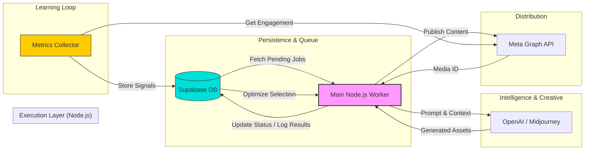

# 👋 Hi, I'm Nabit Mikan Castano

**AI Automation Architect | Generative AI Engineer | E-Commerce Specialist | Conversational AI & WhatsApp agents**  
📍 Berlin, Germany | 🌐 [genflowautomation.com](https://genflowautomation.com)

---

## 🚀 About Me

A few years ago, I grew frustrated with the traditional marketing industry. Everyone was selling the same formulas: "more clicks, more leads, more magic." But behind the noise, real, scalable results were missing. I decided to build what I couldn't find: **intelligent systems that actually work.**

Today, I am an **AI Automation Architect** specializing in **agentic AI systems**. I don't just "automate tasks"; I design self-improving engines that create, publish, and learn autonomously. I blend my background as a **Certified Online Marketing Manager** with AI engineering to transform business problems into robust, production-grade software solutions.

As **CEO of Genflow Automation**, my mission is to free professionals from repetitive work, giving them back the time to create, innovate, and grow.

---

## 🎥 See It In Action

*Watch how the autonomous content system creates, publishes, and optimizes posts in real-time*

---

## 🗺️ Technical Roadmap: From Automation to Autonomous Agency

The Botanery project follows a phased sprint plan to evolve from a content generator into an AI-driven "Growth Engine."

### 🟢 Phase 1: Robust Foundations (Completed)
* **Sprint 0-2**: Infrastructure setup (Node.js + Supabase + Sharp).
* **Sprint 3**: Meta Graph API integration for automated publishing.
* **Sprint 3.1**: Intelligent Image Composition (SVG templates & dynamic branding).

### 🟡 Phase 2: Feedback & Intelligence (Current Focus)
* **Sprint 4 (A1 Collector)**: Real-time metrics ingestion (Likes, Saves, Reach).
* **Sprint 5 (A2 Scoring)**: Implementing performance scoring per product/style.
* **Sprint 6 (A3 Optimizer)**: Activating the Epsilon-Greedy algorithm for autonomous content selection based on ROI.

### 🔵 Phase 3: Advanced Content & Scaling (Future)
* **Sprint 9**: Automated Seamless Carousels (10-slides storytelling).
* **Sprint 10**: AI Video/Reels generation via Remotion/FFmpeg.
* **Sprint 11**: Ads Automation MVP — Turning organic winning posts into paid ads automatically.

### 🚀 Phase 4: Business Expansion
* Integration with Shopify/Zoodrop for real-time inventory-aware posting.
* White-label architecture for multi-tenant "Content Agent as a Service."

---

## 🏗️ Featured Project: Botanery Content Agent

**Botanery** is an autonomous, closed-loop content system designed for e-commerce. Unlike simple linear workflows, this agent makes data-driven decisions to manage the entire content lifecycle for a brand.

### System Architecture

This system utilizes a **Job-Queue architecture** with strict separation of concerns, ensuring the creation process is fault-tolerant and highly scalable.

### Key Features

- **🤖 Fully Autonomous**: No manual intervention required
- **📊 Data-Driven**: Uses epsilon-greedy algorithm for content optimization
- **🔄 Self-Improving**: Learns from engagement metrics in real-time
- **🎨 Brand-Consistent**: Maintains visual identity across all content
- **📈 ROI-Focused**: Automatically optimizes for business metrics

---

## 🛠️ Tech Stack & Certifications

**AI Engineering**: Python, Node.js, LangGraph, OpenAI SDK, Supabase (PostgreSQL)

**E-Commerce**: Online Marketing Manager Certified (510 UE) — Social Media Akademie

---

## 🤝 Let's Connect

If you're building the next generation of AI-powered e-commerce or want to see how autonomous systems change the game — let's talk.

💼 **Services**: AI Consulting, Workflow Architecture & Growth Partnership  
🌐 **Website**: [genflowautomation.com](https://genflowautomation.com)  
📧 **Email**: [contact@genflowautomation.com](mailto:hello@genflowautomation.com)  
💼 **LinkedIn**: [Connect with me](https://linkedin.com/in/nabitmikan)

---

⭐ **Star this repository** if you find these architectures useful!

---

  Built with ❤️ in Berlin | Powered by AI

